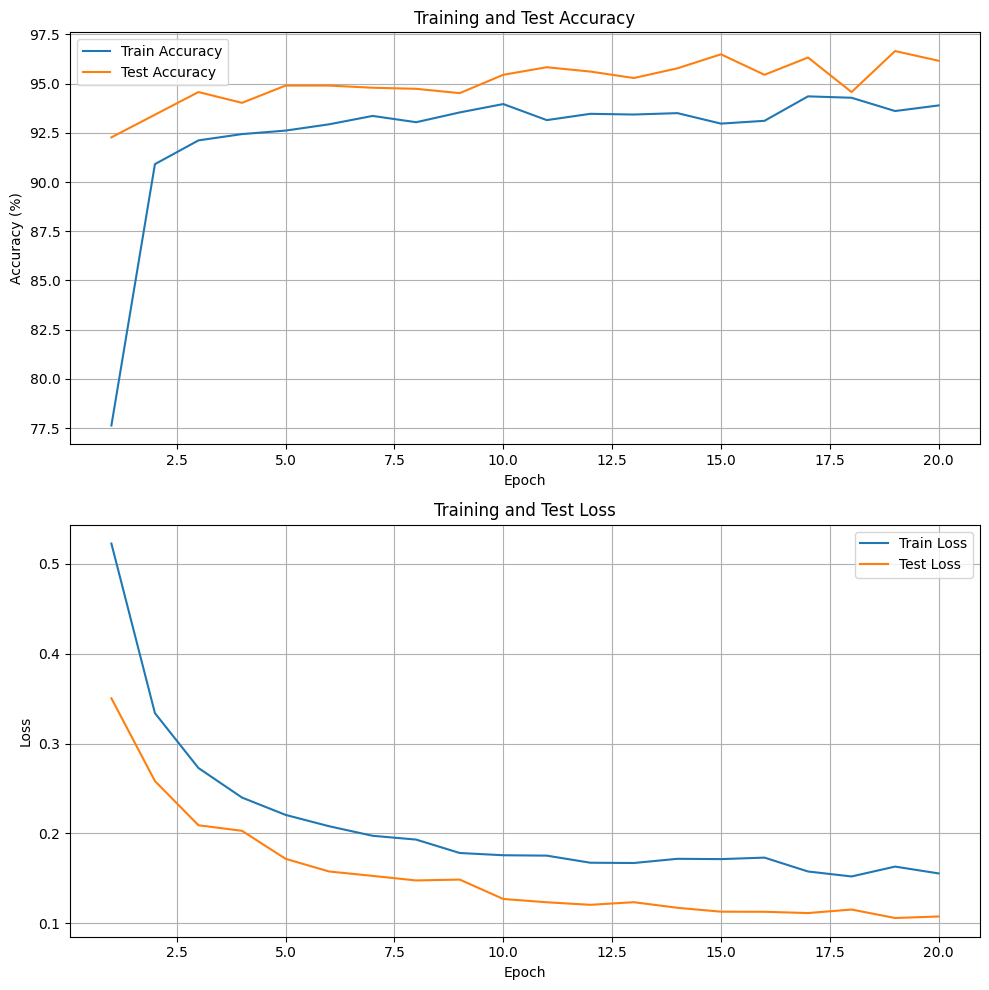
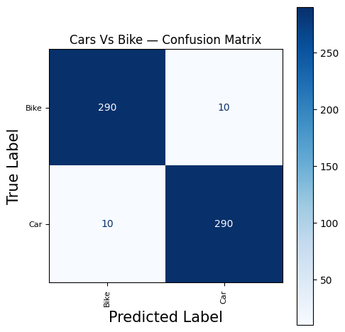
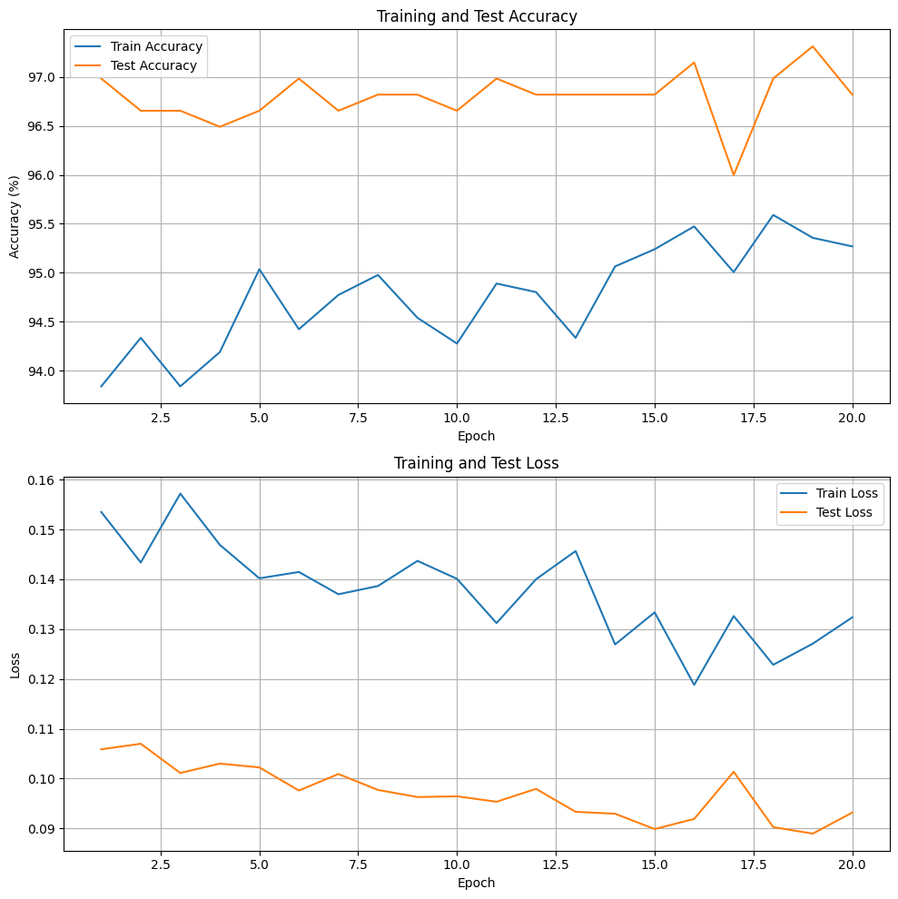
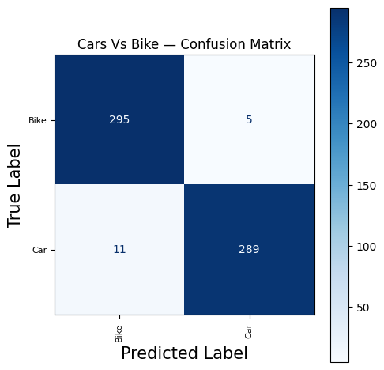

# Car vs Bike Classification (YOLO26n-cls + OpenCV + PyTorch)

A binary image classifier that tells whether a picture contains a **car** or a **bike**. It fine-tunes a pretrained **YOLO26n-cls** model (Ultralytics) with a **custom PyTorch training loop**, and uses **OpenCV edge detection (Canny)** as the preprocessing step. It reaches about **97.3% accuracy and 0.973 macro F1** on the held-out test set.

Notebook on Kaggle: [Kaggle link](http://kaggle.com/code/purabsingla/carvsbike-classification-pytorch/)

---

## Table of Contents
- [Introduction](#introduction)
- [Background: How It Works](#background-how-it-works)
- [Dataset](#dataset)
- [Approach](#approach)
- [Training and Validation Loop](#training-and-validation-loop)
- [Results](#results)
- [Mistakes I Made and What I Learned](#mistakes-i-made-and-what-i-learned)
- [Project Structure](#project-structure)
- [Setup](#setup)
- [Test the Model Yourself](#test-the-model-yourself)
- [Limitations and Future Work](#limitations-and-future-work)

---

## Introduction

The goal of this project is to build an image classification model that identifies whether an image belongs to the **Car** class or the **Bike** class.

It is also a learning project. I wanted to understand how two popular tools work and how they fit together:

1. **OpenCV** (Open Source Computer Vision Library) helps a computer understand what is in a picture. Here I use it to load images, resize them, and detect edges.
2. **Ultralytics YOLO** ("You Only Look Once") is a family of fast computer vision models. I use its pretrained classification version as my starting point.

Instead of using the one-line `yolo.train()` shortcut, I wrote the training pipeline myself in PyTorch, and I put the reusable parts (datasets, dataloaders, training loop, evaluation, plotting) into my own helper file, `pytorch_utils.py`. This kept the notebook short and let me reuse the same code across experiments.

## Background: How It Works

**Image classification** means giving a model an image and asking it to pick one label from a fixed set of classes. This project is **binary classification** because there are only two classes: `Bike` and `Car`.

**YOLO26n-cls** is the classification version of a YOLO model. The **n** stands for *nano*, the smallest and fastest size, which suits limited GPU time on Kaggle. It was pretrained on ImageNet (1000 classes).

**Transfer learning** is the main idea here. The pretrained model already knows general visual patterns such as edges, textures, and shapes. Instead of training from zero, I:
1. **Freeze** the first 6 layers so those general features stay unchanged (this also saves memory).
2. **Replace the final layer**, because the original one outputs 1000 classes and I only need 2.
3. **Fine-tune** the remaining layers on my own data.

**Canny edge detection** is an OpenCV method that keeps only the outlines of objects and removes colors and textures. Every image in this project is converted to an edge map before it reaches the model, so the model has to learn from **shapes only** (for example, two wheels and a handlebar versus four wheels and a body).

**Metrics used:**

| Metric | What it tells you |
|--------|-------------------|
| **Accuracy** | Share of images classified correctly |
| **Precision** | Of all images predicted as a class, how many really were that class |
| **Recall** | Of all real images of a class, how many the model found |
| **F1-score** | Balance of precision and recall in one number |
| **Macro avg** | Average of the per-class scores, treating both classes equally |
| **Confusion matrix** | A table showing which classes get mixed up |

## Dataset

- **Source:** [Car vs Bike Classification Dataset](https://www.kaggle.com/datasets/utkarshsaxenadn/car-vs-bike-classification-dataset) on Kaggle (by Utkarsh Saxena)
- **Classes (2):** `Bike`, `Car`
- **Total images:** 4,000, already split into folders

| Split | Images | Used for |
|-------|--------|----------|
| Train | 2,800 | Training in stage 1 |
| Validation | 600 | Model selection in stage 1 |
| Test | 600 | Final evaluation |
| Train + Val (combined) | 3,400 | Final training in stage 2 |

The data is arranged as `split/class_name/image.jpg`, so it loads directly with torchvision's `ImageFolder`.

## Approach

**Preprocessing (OpenCV)**
1. Read the image with `cv2.imread`
2. Resize to **224 x 224**
3. Convert to grayscale
4. Run **Canny edge detection** (thresholds 100 and 200)
5. Convert back to 3 channels so it fits the model's input

**Augmentation (torchvision v2), training set only**
- `AugMix` (severity 3, mixture width 3, alpha 1.0)
- Convert to float tensor and normalize with ImageNet mean and std

Validation and test images get the same preprocessing and normalization, but no augmentation.

**Model**
- Pretrained `yolo26n-cls.pt` from Ultralytics
- First **6 layers frozen**
- Final linear layer replaced: `1000 outputs -> 2 outputs`

**Training settings**

| Setting | Value |
|---------|-------|
| Loss | CrossEntropyLoss |
| Optimizer | AdamW |
| Learning rate | 1e-4 |
| Batch size | 32 |
| Epochs | 20 per stage |
| Seed | 42 |
| Hardware | Kaggle GPU (CUDA) |

**Two-stage training**
1. **Stage 1:** train on Train, validate on Val, and keep the best epoch.
2. **Stage 2:** continue training on Train + Val combined (more data) and evaluate on the untouched Test set.

## Training and Validation Loop

Each epoch has two phases:

- **Training phase:** the model is in `train()` mode. For every batch I run a forward pass, calculate the loss, run `backward()`, and update the weights.
- **Validation phase:** the model is in `eval()` mode with gradients off (`torch.no_grad()`). It only measures loss and accuracy, with no weight updates.

After every epoch the best-scoring weights are remembered (`best_model_state`), and the best epoch is the one that gets saved at the end. Watching both curves helps to spot **overfitting**, which is when training loss keeps dropping but validation loss stops improving.

## Results

### Stage 1: Train on Train, validate on Val

- Best validation accuracy: **96.66%** (epoch 19)
- Validation macro avg: precision 0.967, recall 0.967, F1 0.967
- Training time: about 342 seconds on a Kaggle GPU

<p align="center">
  
  
</p>

### Stage 2 (final): Train on Train + Val, evaluate on Test

| Class | Precision | Recall | F1-score |
|-------|-----------|--------|----------|
| Bike | 0.964 | 0.983 | 0.974 |
| Car | 0.983 | 0.963 | 0.973 |
| **Macro avg** | **0.974** | **0.973** | **0.973** |

- **Test accuracy: 97.31%**, test loss: 0.089
- Training time: about 381 seconds on a Kaggle GPU

<p align="center">
  
  
</p>

**How to read these results:**
- **Loss and accuracy curves:** validation loss stays below training loss. This is expected because the training images are augmented with AugMix (harder), while validation images are clean, and it also means the model is not overfitting.
- **Confusion matrix (test set, 600 images):** 295 bikes and 289 cars were classified correctly. Only 5 bikes were predicted as cars, and 11 cars were predicted as bikes. The model makes slightly more mistakes on cars, which is why car recall (0.963) is a bit lower than bike recall (0.983).
- Both classes have almost the same F1, so the model is **balanced** and not favoring one class.

## Mistakes I Made and What I Learned

1. **My results changed every day.**
   I got six different versions of this notebook, like collecting infinity stones, and the best one reached 0.9666 macro avg on validation. The same code gave slightly different numbers on different days. The most likely causes are different GPUs/CPUs on Kaggle, library updates, and some random parts that I had not seeded. *Lesson:* seed everything at the very top (`random`, `numpy`, `torch`, CUDA) and also seed the DataLoader, and expect small differences between machines.

2. **Edge detection throws away information.**
   Canny turns every image into black-and-white outlines, so color and texture are lost. It is a good way to learn OpenCV and it still works well here, but a normal RGB image would probably score higher. I would test both and compare.

3. **I picked the best checkpoint using the test set in stage 2.**
   In the final stage the "best epoch" was chosen by test accuracy, and then I reported that same test accuracy. That makes the final number slightly optimistic. *Lesson:* choose the checkpoint on validation data (or just use the last epoch) and touch the test set only once at the end.

4. **Hardcoded Kaggle paths.**
   The notebook uses paths like `/kaggle/input/...` and `/kaggle/working/...`, which break outside Kaggle. *Lesson:* keep paths in one variable at the top so they are easy to change.

5. **Only looking at accuracy.**
   Accuracy alone can hide problems, so I also checked precision, recall, F1, and the confusion matrix.

## Project Structure

```
.
├── carvsbike-classification-pytorch.ipynb   # full training and evaluation
├── pytorch_utils.py                         # helper functions (datasets, dataloaders, training, evaluation, plotting)
├── models/
│   └── yolo_custom_carbike.pt               # trained weights (state_dict)
├── images/
│   ├── loss_curve_stage1_train_val.png
│   ├── confusion_matrix_stage1_val.png
│   ├── loss_curve_final.png
│   └── confusion_matrix_final_test.png
├── requirements.txt
└── README.md
```

> `pytorch_utils.py` must stay in the same folder as the notebook.

## Setup

```bash
git clone https://github.com/YOUR_USERNAME/YOUR_REPO.git
cd YOUR_REPO
pip install -r requirements.txt
```

Built and tested on Kaggle with Python 3.13, PyTorch 2.11 (CUDA 12.8), and Ultralytics 8.4.190. A GPU is recommended for training. Predictions with the saved model also run on CPU.

To retrain, download the [dataset](https://www.kaggle.com/datasets/utkarshsaxenadn/car-vs-bike-classification-dataset) and change the `PATH` variable in the notebook to where you saved it.

## Test the Model Yourself

The model was trained on **edge maps**, so a new image must go through the **same preprocessing** (resize, grayscale, Canny) before prediction. Otherwise the results will be wrong.

```python
import cv2
import torch
from torch import nn
from torchvision.transforms import v2
from ultralytics import YOLO

device = "cuda" if torch.cuda.is_available() else "cpu"
class_names = ["Bike", "Car"]

# 1. Rebuild the same model and replace the head (1000 -> 2 classes)
model = YOLO("yolo26n-cls.pt").model
head = model.model[-1]
head.linear = nn.Linear(head.linear.in_features, len(class_names))

# 2. Load the trained weights
model.load_state_dict(torch.load("models/yolo_custom_carbike.pt", map_location=device))
model.to(device).eval()

# 3. Same preprocessing as in training
def cv2_loader(path):
    img = cv2.imread(path, cv2.IMREAD_COLOR)
    img = cv2.resize(img, (224, 224), interpolation=cv2.INTER_AREA)
    img = cv2.cvtColor(img, cv2.COLOR_BGR2GRAY)
    edges = cv2.Canny(img, 100, 200)
    return cv2.cvtColor(edges, cv2.COLOR_GRAY2RGB)

transform = v2.Compose([
    v2.ToImage(),
    v2.ToDtype(torch.float32, scale=True),
    v2.Normalize(mean=(0.485, 0.456, 0.406), std=(0.229, 0.224, 0.225)),
])

# 4. Predict
x = transform(cv2_loader("your_image.jpg")).unsqueeze(0).to(device)
with torch.no_grad():
    out = model(x)
    logits = out[1] if isinstance(out, (tuple, list)) else out
    probs = logits.softmax(dim=1)
    pred = probs.argmax(dim=1).item()

print(f"Prediction: {class_names[pred]} ({probs[0, pred].item():.2%})")
```

You can also open the notebook on Kaggle and run it from top to bottom: [Kaggle link]

## Limitations and Future Work

- Canny edge preprocessing removes color and texture. Comparing it with plain RGB input is the first thing I would try.
- The final test score is slightly optimistic because the best epoch was chosen on the test set (see mistake 3). A cleaner setup would select on validation data only.
- Stage 2 continues from the stage 1 weights instead of starting from fresh pretrained weights.
- Only two classes. The model has never seen trucks, buses, scooters, or bicycles, so it will still force a "Car" or "Bike" answer for them.
- Results vary slightly across GPUs and library versions.
- Ideas: try a larger YOLO26 size, unfreeze more layers, train on RGB, run several seeds and report mean and standard deviation, and add more vehicle classes.

## Acknowledgements

- [Ultralytics](https://github.com/ultralytics/ultralytics) for the YOLO pretrained weights
- [Utkarsh Saxena](https://www.kaggle.com/utkarshsaxenadn) for the Car vs Bike Classification dataset on Kaggle
